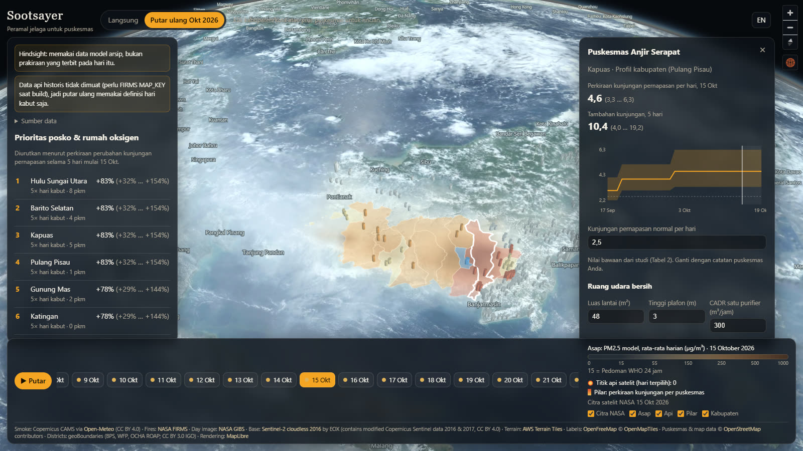
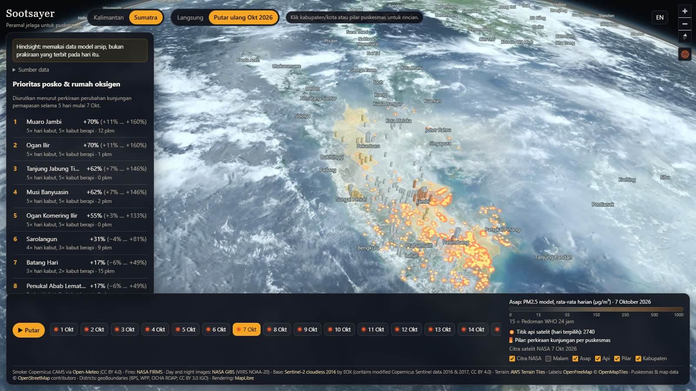
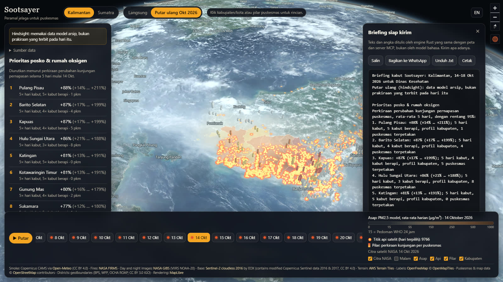

# Sootsayer

**Peramal jelaga untuk puskesmas.** The soot-sayer for community clinics.

**Live app: [sootsayer.vercel.app](https://sootsayer.vercel.app)** ·
[October 2026 replay, Pulang Pisau](https://sootsayer.vercel.app/?mode=replay&date=2026-10-15&district=KT-pulang-pisau) ·
[Sumatra replay](https://sootsayer.vercel.app/?region=sumatra&mode=replay&date=2026-10-07) ·
[Presentation mode](https://sootsayer.vercel.app/?tour=1&lang=en)

Satellites already see the fires, and air-quality apps already show the smoke.
Nobody tells the puskesmas who is coming. Sootsayer forecasts where wildfire
smoke will settle over Kalimantan and Sumatra's peatland provinces in the next
five days and turns it into an expected change in respiratory visits for every
district and mapped puskesmas, always with a 95% range, plus a prep plan and a
briefing a health office can send as is. Everything runs on a real 3D globe
built from open data.



| Sumatra, replay of 7 October 2026 | The briefing a health office can send |
|---|---|
|  |  |

## Why

The 2026 haze season in Indonesia was severe:

- Kemenkes counted [401,586 ISPA cases](https://go.kompas.com/read/2026/11/04/203113274/ministry-of-health-ispa-cases-due-to-forest-fires-reach-401586-in-7-provinces)
  linked to forest and land fires in 7 provinces and 63 districts by 2 November.
- CREA estimated [3,560 deaths from fire smoke in September 2026 alone](https://energyandcleanair.org/indonesias-air-pollution-deaths-surged-by-42-in-september-as-government-resists-declaring-karhutla-a-national-emergency/).
- The government set up [477 rumah oksigen](https://voi.id/en/news/599566) and emergency
  health posts and handed out 5.3 million masks. Those allocation decisions were
  made after the surge arrived.

Sootsayer is decision support for that moment: which districts to prepare
first, how many extra visits to expect, how big a clean-air room has to be,
and a briefing to send to the puskesmas heads.

## What it does

- **Real 3D globe.** MapLibre GL JS v6 globe with atmosphere and terrain, the
  NASA satellite photo of the selected day (and its night image), Sentinel-2
  cloudless base, NASA FIRMS fire detections, and the Copernicus CAMS smoke field.
- **Two regions.** Kalimantan (5 provinces, 56 districts) and Sumatra's
  peatland provinces (Riau, Jambi, Sumatera Selatan; 40 districts). Regions are
  data packs: adding one is a pipeline run, not new code.
- **Five-day outlook.** Each district-day is classified as clear, haze, or
  fire-haze with the definitions of a puskesmas study in Central Kalimantan
  (Phung et al. 2025), and the study's relative risks give the expected change
  in respiratory visits, by haze duration, with 95% ranges.
- **Priority list** for posko and rumah oksigen, ranked by expected relative
  change, so districts with no puskesmas in OpenStreetMap still show up.
- **Briefing for the health office.** One button gives a plain-text briefing
  in Bahasa Indonesia or English: priority districts with ranges, incomplete
  districts, data times, failed sources, method, limits. Copy, share to
  WhatsApp, download, or print. The Rust engine writes it, so the web app and
  the MCP tool send the same bytes.
- **Puskesmas view.** Expected visits per day, an editable baseline (your own
  records stay in your browser), a clean-air room calculator with a
  Corsi–Rosenthal box preset from a US EPA test, and indoor PM2.5 with and
  without a cleaner from measured smoke infiltration.
- **Your own puskesmas list.** Export the OSM list as CSV, correct it or load
  the official list (with usual visits), and import it back. Every rejected
  row is named; nothing leaves the browser.
- **Replay of October 2026** from archived CAMS smoke data and NASA FIRMS fire
  detections (156,658 over Kalimantan, 44,932 over Sumatra, 17 Sep – 31 Oct),
  labelled as hindsight.
- **Presentation mode** (`?tour=1`): a captioned walk through the real app.
- **Agents can ask it.** An MCP server gives Kiro (or any MCP client) the same
  numbers and the same briefing: `list_regions`, `list_districts`, `priority`,
  `haze_outlook`, `clinic_plan`, `daily_brief`.
- **Honest by design.** Every number shows its range and source, failed
  sources are named on screen, and the method's limits sit next to the
  numbers, including that outside Central Kalimantan the study is applied by
  analogy.

## The chimera

| Part | Technology | Job |
|---|---|---|
| Engine | **Rust** (one crate, three faces: library, native CLI, **WebAssembly** with a hand-written C ABI) | Classification, duration, relative risk, expected visits, priority, fire-to-district assignment, point location, clean-air sizing, indoor PM2.5, briefing text |
| Globe | **TypeScript + Vite + MapLibre GL JS v6** (WebGL2, globe projection, terrain) | The 3D view, timeline, panels, CSV, tour, Bahasa Indonesia and English |
| Edge | **Vercel functions** | Cache and trim CAMS (Open-Meteo) and NASA FIRMS per region, which the browser cannot read directly |
| Data | **Python + uv + Shapely** | Region packs: districts (geoBoundaries), puskesmas (OpenStreetMap), CAMS grid, October 2026 replay |
| Agents | **MCP** (Python SDK v2), a **custom Kiro agent**, a **Kiro power** | The outlook and the briefing as tools, on the same Rust engine |

The browser and the agent tool run the same Rust code. `web/scripts/check-parity.mjs`
pushes a real October input of every region through the WebAssembly module and
the native CLI, for the outlook and for the briefing in both languages, and
requires byte-identical output.

## Method in one paragraph

A district-day is a haze day when its daily mean PM10 is at least 100 µg/m³,
and a fire-haze day when it also has a satellite fire detection. Consecutive
haze days are grouped as 1–3, 4–14, or 15+. Relative risks come from Table 4
of [Phung et al. 2025](https://doi.org/10.1093/ije/dyaf169): for example, after
15+ haze days a regency puskesmas sees **+83% respiratory visits (95% range +32%
to +154%)**. The city profile (Palangka Raya) showed no increase, and even a
drop during long haze, which the app explains as patients shifting to
hospitals and posko. Details, assumptions, and limits: [docs/METHOD.md](docs/METHOD.md).
Sources and licenses: [docs/DATA.md](docs/DATA.md).

## Run it locally

Requirements: Node 22, Rust (with `wasm32-unknown-unknown` for engine changes),
Python 3.12 with [uv](https://docs.astral.sh/uv/).

```powershell
npm install --prefix web
npm run dev --prefix web             # http://localhost:5173 (serves api/*.ts too)
```

Useful links: `/?region=sumatra&mode=replay&date=2026-10-07`,
`/?mode=replay&date=2026-10-15&district=KT-pulang-pisau`, `&brief=1` opens the
briefing, `&night=1` the night image, `&lang=en`, `&intro=0` skips the intro,
`/?tour=1` plays the presentation.

Engine and data:

```powershell
cargo test --manifest-path engine/Cargo.toml          # 28 unit + 7 property-based tests
node web/scripts/engine-check.mjs                      # tests, WASM, CLI, parity (every region)
pipeline/.venv/Scripts/python.exe -m sootsayer_pipeline.build_reference              # every region
pipeline/.venv/Scripts/python.exe -m sootsayer_pipeline.build_replay --region sumatra  # set FIRMS_MAP_KEY for fires
```

MCP server (stdio), already registered for Kiro in `.kiro/settings/mcp.json`:

```powershell
uv run --project mcp-server python mcp-server/server.py
```

## A morning briefing with Kiro Crew

[Kiro Crew](https://kiro.dev/docs/crew/) runs scheduled jobs and posts to
Telegram, Slack, Teams, and other channels. To send the Dinkes briefing every
morning: add the Sootsayer MCP server in Crew's Integrations panel (or let
Discover & Sync find it), then ask in chat: *"Every day at 06:00 WIB, call
sootsayer `daily_brief` with region kalimantan, mode live, lang id, and post
`text` exactly as written to our Telegram channel."* The text comes from the
engine, so the job forwards numbers it did not write. (Not tested in this repo:
Crew is not installed on the build machine.)

## Deploy

Production runs on Vercel at [sootsayer.vercel.app](https://sootsayer.vercel.app).
`vercel.json` builds `web/` and deploys `api/air.ts` and `api/fires.ts` as
functions; `.vercelignore` keeps the engine, pipeline, MCP, and power folders
out of the upload (the browser uses the prebuilt
`web/src/wasm/sootsayer_engine.wasm`). No secrets are needed for the live view.

## Built with Kiro

- **Spec-driven:** `.kiro/specs/haze-clinic-outlook/` (v1) and
  `.kiro/specs/outlook-v2/` (briefing, regions, waiting room, CSV, tour,
  agents) hold the requirements (EARS), design decisions, and tasks. The
  designs changed when the build found facts: OpenStreetMap maps only part of
  the puskesmas, so ranking moved to relative change; Open-Meteo's per-minute
  limit, so live requests use land and coast cells, one region at a time; and
  all of Indonesia would cost about 2,655 calls per refresh, so coverage stays
  with the haze regions.
- **Steering:** `.kiro/steering/` sets the house rules (real data only, ranges
  not single numbers, limits on screen), the sources and licenses, and the
  layout.
- **Hooks:** `engine-check-on-save` runs tests, rebuilds WASM and CLI, and
  checks parity whenever engine code is saved; `method-citation-check` keeps
  study numbers and citations consistent; `house-rules-ui-check` reviews UI
  edits against the steering. During v2, reviews with the UI hook's checklist
  found English-only CSV errors and an English label inside the Indonesian
  briefing, and the citation checklist found METHOD.md missing the new
  constants.
- **Property-based testing:** proptest guards the engine's invariants,
  including that every briefing carries its limits, its disclaimer, and a range
  on every ranked line.
- **MCP:** the Sootsayer MCP server lets an agent in Kiro answer "which
  districts need rumah oksigen this week?" and send the briefing.
- **Custom agent:** `.kiro/agents/sootsayer-briefer.md` briefs only from the
  MCP tools and keeps ranges, data times, failed sources, and limits.
- **Power:** `power-sootsayer/` packages the MCP server with two skills
  (`haze-briefing`, `add-a-region`).

## License

Code: MIT, see [LICENSE](LICENSE). Data keeps its own licenses (CC BY 4.0,
CC BY 3.0 IGO, ODbL, NASA open data), listed in [docs/DATA.md](docs/DATA.md).
